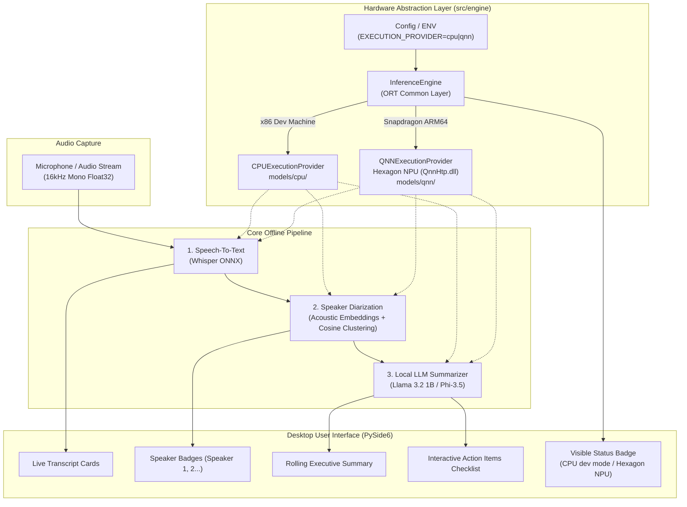

# ⚡ Snapdragon Offline Meeting Companion (Copilot+ PC)

An entirely offline, privacy-first AI meeting companion built for **Snapdragon-powered HP laptops (ARM64 Copilot+ PCs)**. All speech-to-text, speaker diarization, and LLM summarization run **100% locally on the Qualcomm Hexagon NPU** using models compiled via **Qualcomm AI Hub**.

Zero cloud calls. No audio leaves your laptop. Completely air-gapped security and zero latency jitter from internet drops.

---

## 🎯 Hardware-Portable Architecture

This codebase is architected from day one to be **100% hardware-portable across x86 development machines (e.g. HP Victus) and Snapdragon ARM64 Copilot+ PCs**:

- **Hardware Abstraction Layer (`InferenceEngine`)**: A single unified engine manages model loading, hardware discovery, and provider fallback. App logic never hardcodes hardware-specific calls.
- **ONNX Runtime as the Common Layer**: Uses ONNX Runtime for all STT and LLM pipelines, supporting `CPUExecutionProvider` on x86 dev PCs and `QNNExecutionProvider` on Snapdragon Hexagon NPUs under one identical API.
- **Separated Model Artifacts**: Model binaries are decoupled into `/models/cpu` (x86 dev) and `/models/qnn` (Snapdragon target) and tracked via `.gitignore`.
- **Visible Hardware Status**: Startup auto-detection displays active execution provider prominently in the UI (`Running on: CPU (dev mode)` vs `Running on: Snapdragon Hexagon NPU (QNN)`).



---

## 📁 Repository Structure

```
snapdragon-meeting-companion/
├── config/
│   └── settings.yaml              # Config-driven execution provider & model paths
├── docs/
│   └── qualcomm_ai_hub_workflow.md # Guide to compile & deploy models on Hexagon NPU
├── exports/                       # Exported Markdown & JSON meeting minutes
├── models/                        # Target-separated offline model artifacts
│   ├── README.md                  # Model placement and download documentation
│   ├── cpu/                       # x86 Dev PC ONNX models (stt, diarization, llm)
│   └── qnn/                       # Snapdragon Hexagon NPU compiled models
├── scripts/
│   └── dev/                       # Isolated x86 dev/prototyping scripts (zero torch in app)
├── src/
│   ├── config.py                  # Strongly typed config with environment variable support
│   ├── pipeline.py                # Pipeline orchestrator & Qt Signal dispatcher
│   ├── engine/                    # HARDWARE ABSTRACTION LAYER
│   │   ├── __init__.py
│   │   └── inference_engine.py    # ONNX Runtime provider discovery & fallback
│   ├── audio_capture/
│   │   └── capture.py             # 16kHz mono audio capture with VU level metering
│   ├── stt_engine/
│   │   └── whisper_stt.py         # Whisper STT via ONNX Runtime (CPU/QNN)
│   ├── diarization/
│   │   └── diarizer.py            # Speaker clustering via ONNX embeddings
│   ├── summarizer/
│   │   └── llm_summarizer.py      # Local LLM / NLP rolling summary & action items
│   └── ui/
│       ├── styles.py              # Windows 11 Fluent dark theme & status badges
│       └── main_window.py         # Desktop UI with live hardware status badge
├── main.py                        # Entry point (GUI, CLI test, --provider, --mock)
├── requirements-dev.txt           # x86 Dev PC dependencies (CPUExecutionProvider)
├── requirements-arm.txt           # Snapdragon ARM64 dependencies (Qualcomm QNN SDK)
├── requirements.txt               # Base dependencies
├── .env.example                   # Example hardware environment configuration
├── .gitignore                     # Excludes model binaries, venvs, and recordings
└── LICENSE                        # MIT License
```

---

## 🚀 Setup & Installation

Clone the repository to your machine:
```bash
git clone https://github.com/your-repo/snapdragon-meeting-companion.git
cd snapdragon-meeting-companion
```

### Option A: If you are on an x86 Dev Machine (HP Victus / Intel / AMD)
You develop on CPU without needing CUDA or Snapdragon hardware:

```powershell
# 1. Install x86 dev dependencies
pip install -r requirements-dev.txt

# 2. Launch Desktop UI in dev mode
python main.py
```
*The app will automatically initialize with `CPUExecutionProvider` and display:*
`💻 Running on: CPU (dev mode)`

### Option B: If you are on a Snapdragon ARM64 Laptop (Copilot+ PC)
When running on Snapdragon X Elite / Plus silicon:

```powershell
# 1. Install ARM64 & Qualcomm QNN dependencies
pip install -r requirements-arm.txt

# 2. Export / copy compiled models into models/qnn/
#    (See docs/qualcomm_ai_hub_workflow.md)

# 3. Launch Desktop UI with Hexagon NPU acceleration
python main.py --provider qnn
```
*The app will automatically initialize on the Hexagon NPU and display:*
`⚡ Running on: Snapdragon Hexagon NPU (QNN)`

---

## 🎮 Running the Application

### 1. Launch Interactive Desktop GUI
```powershell
# Run with default config
python main.py

# Force mock simulation (perfect for UI and demo testing without model weights)
python main.py --mock

# Explicitly test QNN provider resolution (with automatic graceful fallback on x86)
python main.py --provider qnn
```

**UI Features:**
- **Prominent Status Badge**: Displays real-time hardware execution provider (`CPU (dev mode)`, `Snapdragon Hexagon NPU`, or `CPU (dev mode - QNN fallback)`).
- **Live VU Meter**: Real-time microphone input level visualization.
- **Live Transcript**: Dynamic utterance stream with individual speaker color chips and confidence scores.
- **Rolling Executive Summary**: Instant bulleted summary of key topics.
- **Action Items Checklist**: Automatically extracted tasks with assignees (`@Athish`), priorities, and interactive checkmarks.
- **Hardware Info Dialog**: Complete hardware diagnostics inspection dialog.
- **Offline Export**: Save meeting minutes in Markdown or JSON format to `exports/`.

### 2. Headless CLI Smoke Test
Run an end-to-end headless pipeline test in the terminal (useful for CI/CD or quick testing):
```powershell
python main.py --cli-test
```
Simulates audio turns, exercises the pipeline, and outputs `exports/test_cli_meeting_notes.md`.

---

## ⚙️ Configuration & Hardware Switching

You can configure the active execution provider in three different ways:

1. **Via CLI Argument**:
   ```bash
   python main.py --provider cpu
   python main.py --provider qnn
   ```
2. **Via Environment Variable** (or `.env` file):
   ```ini
   EXECUTION_PROVIDER=cpu   # or 'qnn'
   ```
3. **Via `config/settings.yaml`**:
   ```yaml
   device:
     execution_provider: "cpu"  # 'cpu' for dev, 'qnn' for Snapdragon NPU
     allow_fallback: true
     qnn_backend_path: "QnnHtp.dll"
   ```

### Graceful Fallback Guarantee
If `EXECUTION_PROVIDER=qnn` is requested on an x86 host (or if the QNN execution provider DLL is absent), the `InferenceEngine` **never crashes**. Instead, it automatically falls back to `CPUExecutionProvider` and visibly tags the status as:
`⚠️ Running on: CPU (dev mode - QNN fallback)`

---

## 🧠 Qualcomm AI Hub Model Workflow

To compile and drop in on-device models for Hexagon NPU acceleration:
1. Refer to [docs/qualcomm_ai_hub_workflow.md](docs/qualcomm_ai_hub_workflow.md) for full CLI instructions.
2. Models are compiled using `qai-hub` targeting `"Snapdragon X Elite CRD"`.
3. Drop the generated `.onnx` and configuration files into `models/qnn/stt/`, `models/qnn/diarization/`, and `models/qnn/llm/`.

---

## 🔒 Offline Privacy Guarantee

- **Air-Gapped Operation**: Functions with Wi-Fi / Ethernet completely disabled.
- **Zero Cloud API Keys**: No OpenAI, Anthropic, or external server calls.
- **Local Persistence**: Transcripts are only saved when explicitly exported by the user.

---

## 📄 License
This project is licensed under the [MIT License](LICENSE).